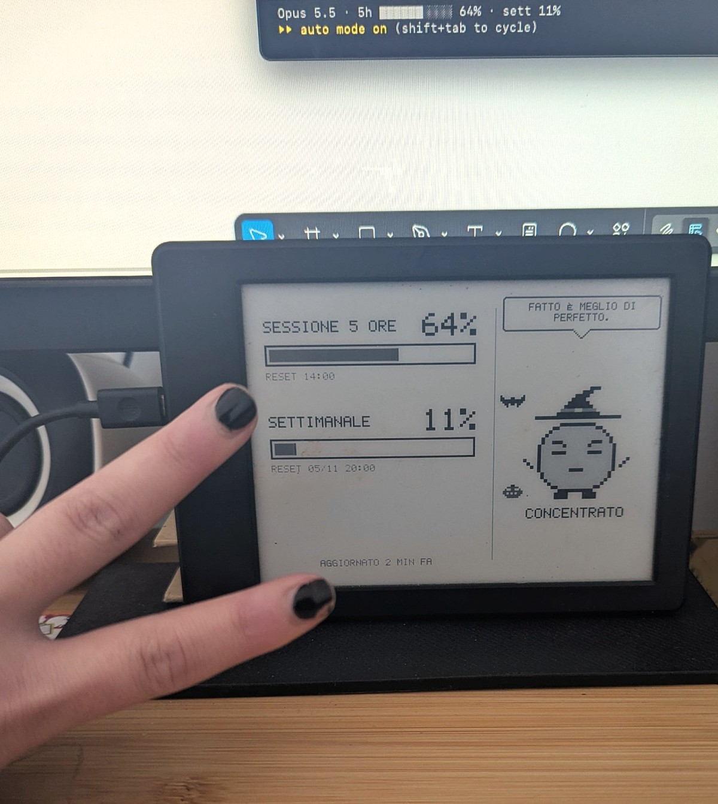
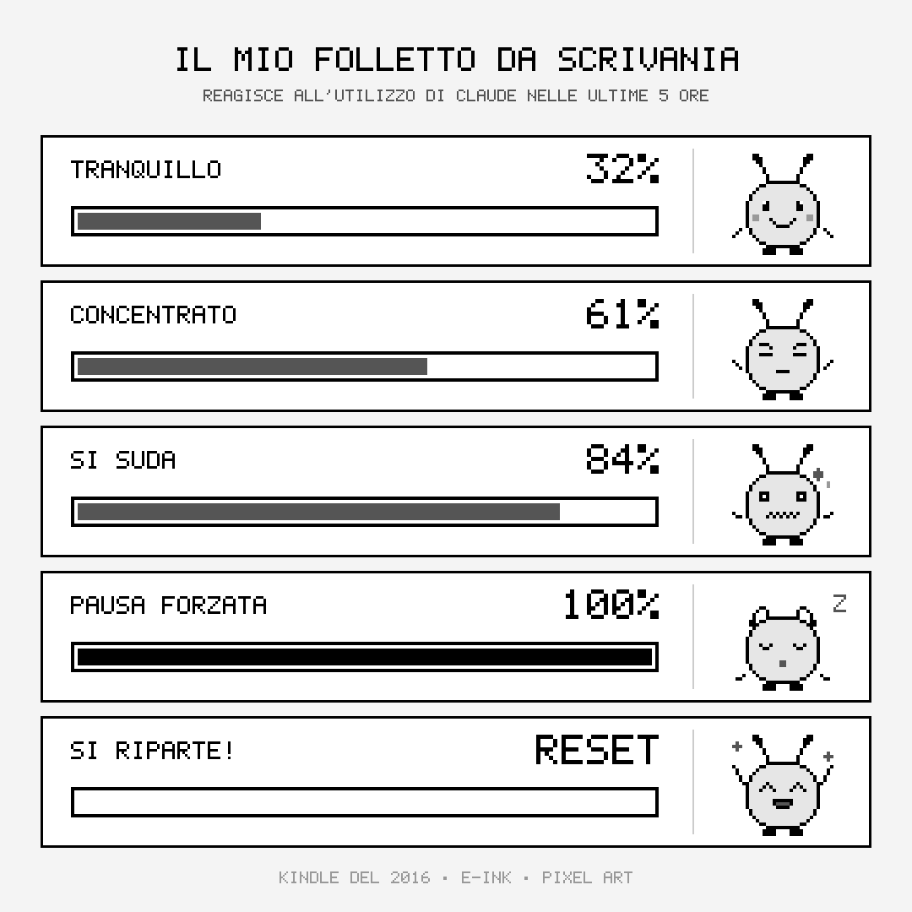
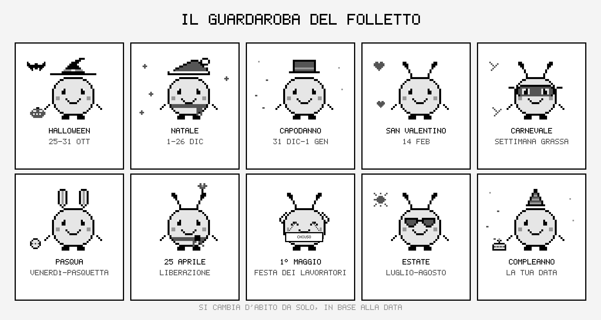
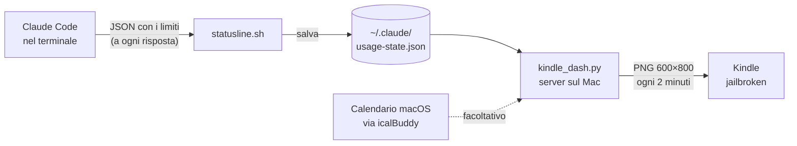
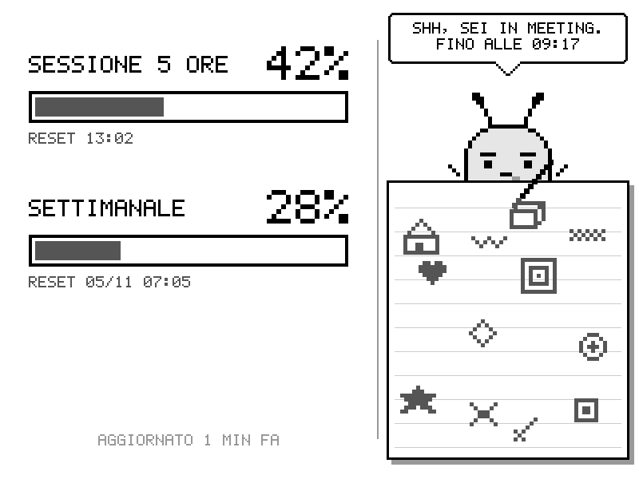

# Folletto 🧚 — l'utilizzo di Claude su un vecchio Kindle

Un folletto in pixel art che vive su un Kindle e mostra a colpo d'occhio quanto hai usato Claude: la sessione delle ultime 5 ore e il limite settimanale. Cambia espressione in base all'utilizzo, ogni tanto pensa ad alta voce in un fumetto, si traveste per le feste e, se colleghi il calendario, durante i meeting scarabocchia su un quaderno.



| Espressioni | Guardaroba |
|---|---|
|  |  |

Tutto gira in locale, sul Mac e sul Kindle: niente account, niente chiavi API, **zero token consumati**.

---

## Come funziona



1. **Claude Code** passa a ogni risposta, a uno script di status line, le percentuali dei limiti del tuo account (`rate_limits.five_hour` e `seven_day`).
2. **`statusline.sh`** mostra le barre in fondo al terminale e salva i numeri in `~/.claude/usage-state.json`.
3. **`kindle_dash.py`** è un piccolo server Python, senza dipendenze, che parte da solo all'accensione del Mac. Legge quel file e disegna un'immagine in scala di grigi con barre, folletto, fumetto e costume del giorno. Il font e la pixel art sono disegnati nel codice, pixel per pixel.
4. **Il Kindle** scarica l'immagine dalla rete di casa ogni 2 minuti e la mostra a schermo intero con `eips`, con l'interfaccia del Kindle spenta.

**Da sapere**
- I numeri sono quelli del tuo account, ma si aggiornano solo quando usi Claude Code su quel Mac. Se usi Claude dal browser, i consumi contano lo stesso, ma il folletto li vede al messaggio successivo nel terminale.
- I dati dei limiti arrivano solo con un abbonamento Claude (Pro, Max o Team). Con una chiave API non ci sono.
- Se il Mac è spento, il Kindle tiene l'ultima immagine e mostra "Mac non raggiungibile". Riparte da solo quando il Mac torna acceso.

### Il folletto

| Sessione 5 ore | Umore |
|---|---|
| 0–50% | tranquillo |
| 50–70% | concentrato |
| 70–90% | suda |
| 90–100% | si addormenta |
| appena azzerata | si sveglia e riparte |

- **Fumetti**: il pensiero cambia ogni 20 minuti, in base all'ora del giorno e all'umore. Puoi aggiungere i tuoi in `~/.claude/folletto/pensieri.txt`, una frase per riga.
- **Costumi**: Halloween, Natale, Capodanno, San Valentino, Carnevale e Pasqua (calcolati ogni anno), 25 aprile, 1° maggio, estate e il tuo compleanno.
- **Modalità meeting** (facoltativa): se c'è un evento in corso nel Calendario di macOS, il folletto scarabocchia su un quaderno che si riempie man mano che il meeting va avanti.



---

## Cosa serve

- Un **Mac** con [Claude Code](https://docs.claude.com/en/docs/claude-code) e un abbonamento Claude
- [Homebrew](https://brew.sh), per installare `jq` e, se vuoi, `icalBuddy`
- Un **Kindle jailbroken** con **KUAL**. Testato su Kindle base di 8a generazione (2016) con firmware 5.16.2.1.1
- Mac e Kindle sulla **stessa rete Wi-Fi**

> ⚠️ Il jailbreak è a tuo rischio e non è supportato da Amazon. Segui la guida aggiornata su [kindlemodding.org](https://kindlemodding.org): il metodo giusto dipende da modello e firmware.

## Installazione

**1. Sul Mac**

```bash
git clone https://github.com/federica-uiux/kindle-folletto.git
cd kindle-folletto
bash install.sh sinistra     # verticale | sinistra | destra
```

L'argomento indica come terrai il Kindle: `verticale`, oppure in orizzontale con la porta di ricarica a `sinistra` o a `destra`.

Lo script:
- collega la status line a Claude Code, dopo aver fatto un backup di `~/.claude/settings.json`
- installa il server in `~/.claude/folletto` e lo fa partire a ogni accensione
- crea sulla Scrivania la cartella `folletto` con l'indirizzo del tuo Mac già impostato

Apri http://localhost:8765/ per vedere l'anteprima. Poi riavvia Claude Code e manda un messaggio: il folletto si sveglia.

**2. Sul Kindle**

1. Collega il Kindle e copia la cartella `folletto` della Scrivania dentro `extensions/`.
2. Su Mac, per togliere i file nascosti che a volte confondono il Kindle: `dot_clean /Volumes/Kindle`. Poi espelli.
3. Apri **KUAL**, poi **Folletto** e **Avvia dashboard**.

Per tornare al Kindle normale, tieni premuto il tasto di accensione finché si riavvia.

**Modalità meeting** (facoltativa): lancia una volta `icalBuddy eventsNow` e consenti l'accesso al Calendario. Per verificare durante un meeting: `python3 ~/.claude/folletto/kindle_dash.py --prova-meeting`.

## Personalizza

In cima a `mac/kindle_dash.py`:

```python
NOME = "Ada"          # per gli auguri di compleanno
COMPLEANNO = (9, 7)   # (mese, giorno)
```

Frasi, costumi e date sono tutti in chiaro nello stesso file (`PENSIERI`, `COSTUMI`). Dopo una modifica, rilancia `bash install.sh <orientamento>`: il Kindle non va toccato.

## Extra: widget nella barra dei menu

`extras/swiftbar/claude-usage.30s.sh` è un plugin per [SwiftBar](https://github.com/swiftbar/SwiftBar) che mostra la percentuale della sessione nella barra dei menu del Mac. Diventa arancione sopra il 70% e rosso sopra il 90%. Copialo nella cartella dei plugin di SwiftBar.

## Problemi comuni

| Sintomo | Causa probabile |
|---|---|
| Il folletto dice "nessun dato" | Claude Code non ha ancora risposto dopo l'installazione: manda un messaggio |
| "Mac non raggiungibile" | Mac spento o in stop, reti diverse, oppure il Mac ha cambiato indirizzo (rilancia `install.sh` e ricopia la cartella) |
| Sul Kindle riappaiono le copertine | L'interfaccia non si è spenta: riavvia il Kindle e rilancia da KUAL |
| macOS chiede di consentire connessioni a Python | Consenti: è il Kindle che chiede l'immagine |

## Disinstallare

```bash
bash uninstall.sh
```

Sul Kindle basta cancellare `extensions/folletto`.

## Struttura

```
install.sh / uninstall.sh
mac/statusline.sh          status line di Claude Code → usage-state.json
mac/kindle_dash.py         server + disegno (font, folletto, costumi, fumetti, meeting)
kindle/folletto/           estensione KUAL (config.sh generato da install.sh)
extras/swiftbar/           widget facoltativo per la barra dei menu
docs/                      immagini del README
```

---

Ideato e progettato da Federica Cutrera, costruito con [Claude Code](https://claude.com/claude-code).
